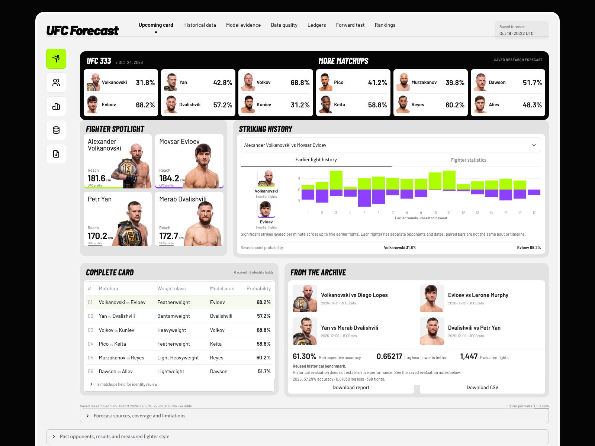
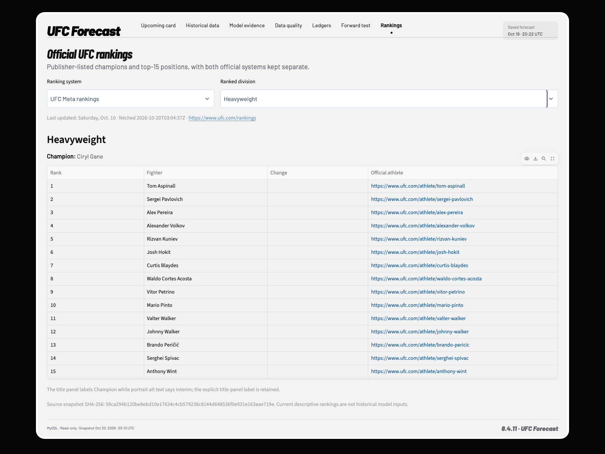
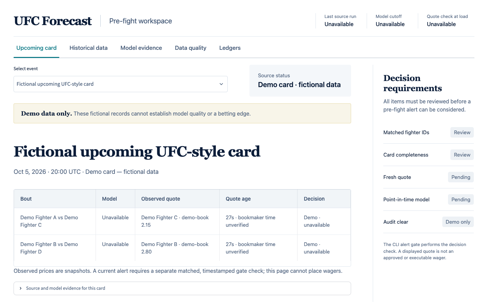

# UFC Forecast — MySQL Data Engineering Case Study

A combat-sports data pipeline with immutable source captures, normalized **MySQL** datasets, explicit quality holds, scheduled refreshes, failed-run notifications, evaluated models and a shareable prediction dashboard. MySQL is the default database for the pipeline, research, dashboard and forecast ledger.

**Explore:** [Dashboard screenshots](#screenshots) · [Architecture](#architecture) · [MySQL runtime](docs/MYSQL_RUNTIME.md) · [Verification](docs/PIPELINE_VERIFICATION.md)

## Run locally

With Python 3.11+, uv and MySQL 8.4 installed:

```sh
uv sync --frozen --all-extras
. .venv/bin/activate
# First installation only: create a separate local project instance.
.venv/bin/python scripts/local_mysql.py setup
.venv/bin/python scripts/local_mysql.py install-service
ufc-mysql init
./scripts/demo.sh
```

Open `output/pipeline-demo-mysql/index.html`. The demo writes an isolated **synthetic MySQL dataset** using the production normalizer; it never replaces the real archive or its active SQL views. It needs a running configured MySQL server. Connection settings come from owner-private configuration or `UFC_MYSQL_*` environment variables, outside Git. [Local server and Workbench setup](docs/LOCAL_MYSQL.md).

For an existing installation with retained local evidence, migrate once and preserve the originals:

```sh
ufc-mysql bootstrap --project-root . --receipt output/NEW-MIGRATION/receipt.json
ufc-pipeline refresh
ufc-mysql rankings
streamlit run app.py --server.address 127.0.0.1
```

A clean clone can run the synthetic demo, fetch the canonical archive, and load official rankings. Frozen forecast regeneration also needs the retained research source evidence; private archives and credentials are excluded from Git. The public PDF, HTML and CSV remain readable without a server.

| Evidence | Storage |
|---|---|
| Normalized statistics, research and operating records | Separate native MySQL datasets |
| Rankings, evaluations and published forecast payloads | Versioned MySQL documents |
| Frozen forecasts and settlements | Append-only MySQL hash chain |
| Raw captures and source hashes | Immutable local files and MySQL receipts |
| Shareable reports | Verified PDF, HTML, CSV and JSON exports |
| Demo inputs | Checked-in synthetic fixtures, isolated from real publications |

The local refresh runs at **09:00** through launchd and supports Mac failure notifications. The Mac must be awake and logged in. [Scheduling and recovery](docs/PIPELINE_OPERATIONS.md). The pipeline does not retrain a model during refresh or page requests.

## Architecture

[](docs/diagrams/statistics-pipeline.svg)

The demo and real archive share the normalizer and use separate MySQL namespaces. Real refreshes normalize directly into immutable MySQL versions, enforce quality gates, publish analytical views, and commit the statistics alias with its publication receipt. Rankings and frozen forecasts are versioned MySQL documents; the dashboard reads published evidence.

[Full-size SVG](docs/diagrams/statistics-pipeline.svg) · [Editable Mermaid source](docs/diagrams/statistics-pipeline.mmd) · [Export instructions and publication boundaries](docs/diagrams/README.md)

## Screenshots

**UFC prediction dashboard.** The saved V6 research edition with official UFC fighter portraits, earlier-round statistics, selectable matchups and verified report downloads. [Launch the dashboard](#dashboard-and-operating-workflow).

[](docs/assets/screenshots/ufc-dashboard.png)

**Official division rankings.** Current Meta and media systems, each published champion and 15 contender rows, with source dates and explicit ties.

[](docs/assets/screenshots/ufc-rankings.png)

**Searchable history.** Every retained card and bout, with methods, reach measurements and quality holds. [View the archive screenshot](docs/assets/screenshots/ufc-history.png).

**Actual MySQL warehouse.** Workbench connected to the project instance, with normalized tables and the archive verification query. The real archive contains 793 cards, 8,950 bouts, 8,818 usable paired-stat bouts and 132 held bouts. [Run the screenshot query](sql/mysql/portfolio_screenshot.sql).

[](docs/assets/screenshots/mysql-workbench.png)

**Synthetic demo report.** Captured from the generated report in Chrome. The production parser retains missing values and holds an incomplete paired-round bout; all five cards and six bouts in this demo are invented.

[](docs/assets/screenshots/pipeline-demo.jpg)

[Screenshot provenance](docs/assets/screenshots/README.md). Screenshots are dated evidence; running the commands produces the current local artifacts.

## Model and prediction reports

A reproducible UFC winner model with a shareable, source-backed prediction report. The current edition forecasts **UFC 333: Volkanovski vs. Evloev, October 24, 2026**. It scores six matchups and lists all eight identity-held matchups without invented probabilities.

**Open the deliverable:** [PDF report](output/pdf/UFC-333-V6-Full-Statistics-Report.pdf) · [Browser report](output/ufc333-20261019-v6-final/prediction-report.html) · [CSV](output/ufc333-20261019-v6-final/prediction-report.csv) · [Forecast JSON](output/ufc333-20261019-v6-final/prediction-report.json)

## Reach and fight statistics

The reusable **all-card statistics pipeline** now supports archive refresh, historical backfill, per-card comparisons and evaluated model training. Start with [All-card statistics](docs/ALL_CARD_STATISTICS.md), or run `ufc-statistics --help`. The normalized store covers the retained archive rather than a single event; original databases and frozen reports are preserved.

All **12 scored fighters** have dated official reach and earlier-fight strike statistics available to V6. The report shows reach, strikes landed and absorbed per minute, striking accuracy and defense, takedown averages, and other available profile stats with units and sources. It records how many earlier fights supplied model statistics for each fighter.

The model uses opponent-adjusted accuracy from paired per-fight significant-strike counts, with whole event dates withheld until after prediction. Current career averages are displayed for context; they never replace earlier-fight inputs. Historical archive joins require exact names, date, outcome and complete paired rounds. Unresolved identities and genuinely absent granular fields remain explicit. Inconsistent official takedown-accuracy panels are omitted rather than corrected by guesswork.

## Model results

V6 adds ten striking and grappling metrics from the last five available fights, with shrinkage for small samples and whole-date ties. It retains V5's original history features. Three feature families were declared before development evaluation; the winner was frozen before the reused fixed benchmark was evaluated. Promotion required lower development and fixed log loss, no decrease in fixed winner accuracy, and sufficient coverage.

| Comparison | Bouts | V5 accuracy | V6 accuracy | V5 log loss | V6 log loss |
|---|---:|---:|---:|---:|---:|
| Fixed historical benchmark | 1,447 | 59.16% | **61.30%** | 0.66144 | **0.65217** |
| Rolling audit, 2016–2026 | 5,278 | 59.98% | **61.63%** | 0.65952 | **0.65360** |
| Latest partial year, 2026 | 398 | 57.29% | 57.29% | **0.67366** | 0.67830 |

V6 makes **31 more correct picks** on the fixed benchmark. Its paired event-date bootstrap loss interval versus V5 is **[-0.01715, -0.00136]**. The 2026 slice has unchanged pick accuracy and worse probability log loss; the pooled gain does not establish improvement in the latest year.

These are reused retrospective benchmarks, not a fresh holdout or evidence of live profit. The rolling pool includes development years. Source, identity and selection uncertainty are outside the bootstrap interval. Historical reach is an approximate static attribute with unknown measurement dates. Full reach plus rich-stat coverage is 532/1,447 (36.77%) on the benchmark; missing evidence remains explicit.

The all-card store retains **793 cards, 8,950 distinct bouts and 4,629 fighter profiles**. It has 8,818 usable paired-stat bouts (98.53%); 132 are held for identity, event or round-data gaps. Reach is available for 2,490 profiles; unavailable measurements are not invented. Reports can be generated for any retained card or a supplied future roster. The canonical archive spans March 1994 to October 17, 2026. Original research result labels remain frozen through September 19; rich history uses safely linked earlier archive fights without silently adding target labels.

## Style, finishes and opponent-strength experiment

V7 tests measured clinch/ground/body/leg strike shares, takedown pressure, prior KO/submission wins and losses, and opponents' pre-bout archive strength. Two candidate families were declared before bounded 2016–2023 selection; all target and same-date results are withheld.

The selected 43-feature candidate **did not improve the reused historical benchmark**: 61.16% accuracy and 0.65386 log loss, versus V6's 61.30% and 0.65217 across 1,447 bouts. V6 remains the delivered model. More inputs do not guarantee better predictions. The complete [protocol, selection and evaluation](reports/mysql-v7-20261020/) are retained; neither result is a fresh holdout.

## Reproduce and verify

Use Python 3.11+ from the repository root:

```sh
python3 -m venv .venv
source .venv/bin/activate
python -m pip install -e '.[dashboard,reports]'
python -m unittest discover -s tests
```

The delivered PDF, HTML, CSV and public JSON can be read without a database or API key. Regenerating forecasts requires the retained local research database and raw source captures; these are excluded from Git. Existing editions are preserved. See [the delivery record](docs/REPORT_DELIVERY.md) for exact experiment reproduction, source limitations and verification.

Generate a new, explicitly dated edition from verified captures:

```sh
ufc-model-report --card reports/ufc333_card_20261019.json \
  --history mysql:research-complete \
  --statistics-db mysql:statistics-v6 \
  --athlete-facts reports/ufc333_fighter_stats_20261019.json \
  --output-dir output/NEW-FORECAST-EDITION
python scripts/render_prediction_pdf.py \
  output/NEW-FORECAST-EDITION/prediction-report.json \
  --output output/pdf/NEW-FORECAST-EDITION.pdf
```

Refresh source evidence before a later run. The saved card and athlete facts are timestamped snapshots, not live feeds. New reports reject changed evidence, post-cutoff captures, started events, missing core facts and ambiguous identities. A new event needs its own source-listed card and athlete manifests.

## Dashboard and operating workflow

```sh
uv sync --frozen --all-extras
uv run --frozen --all-extras streamlit run app.py --server.address 127.0.0.1
```

Open `http://127.0.0.1:8501`. The default is **MySQL**, with seven populated sections: Upcoming card, Historical data, Model evidence, Data quality, Ledgers, Forward test and Rankings. Database failures appear as unavailable; the app never silently falls back to SQLite or a local report. The published forecast must match its verified export manifest before downloads are offered.

Historical data searches every retained card and bout with date, division, quality and reach filters. The quality section exposes source hashes, nullable fields and identity/date holds. Ledgers show actual stored entries, including truthful empty states. Forward test separates the recovered UFC 332 forecast from the pre-start UFC 333 freeze and its pending outcome.

Rankings show the champion and all 15 published contenders for every active division, with official **Meta** and **media** systems, source update dates, capture time and links. Tied positions and skipped numbers remain as published. Current rankings are descriptive; they are not used as historical features.

The card's past-fight panel shows prior opponents, outcomes, finish methods, rounds, times, pre-bout archive Elo and measured striking/grappling style with sample counts. Held source rows remain visible and excluded from feature aggregates.

The history chart uses [retained earlier-fight observations](assets/data/README.md): 47 fighter-fight records and 136 rounds across the 12 scored fighters, with up to five earlier fights per fighter. Hover a bar for its opponent, date, round and observed duration. The two series describe separate fight histories; they are not live momentum or a shared timeline. The statistics view provides eight reach, striking and grappling comparisons, and archive tiles link to their UFCStats bout sources.

The four-fighter grid, icon rail, light-gray panels, black matchup strip, condensed headings and lime/purple comparisons are adapted from [VALMAX's sports dashboard reference](https://dribbble.com/shots/26961358-Live-Sports-Analytics-Dashboard). Real fighter portraits load directly from official UFC image URLs with [source attribution](assets/fighters/README.md); they need internet access. Licensed fonts, saved data and downloads are local. The approved sports layout is preserved across the seven sections. [Design verification](design-qa.md) records the reference comparison and browser checks.

Publish editions through explicit CLI jobs; page requests read committed evidence only. Default handles are `mysql:operating`, `mysql:research-complete`, `mysql:statistics` and `mysql:forecast`. Exact immutable version handles preserve earlier experiments. Legacy SQLite inputs remain available only for explicit migration and regression fixtures. [Runtime and migration contract](docs/MYSQL_RUNTIME.md).

<details>
<summary>Earlier dashboard capture with fictional demo data</summary>

Captured from the earlier Streamlit dashboard with the project's fictional demo database. These records do not establish model quality or a betting edge.



</details>

## Documentation

- [Data engineering case study and architecture](docs/DATA_ENGINEERING_CASE_STUDY.md)
- [MySQL warehouse, publication semantics and SQL](docs/MYSQL_WAREHOUSE.md)
- [Separate local MySQL instance and Workbench connection](docs/LOCAL_MYSQL.md)
- [Pipeline refresh, scheduling and recovery](docs/PIPELINE_OPERATIONS.md)
- [Verified local runs, tests and next increments](docs/PIPELINE_VERIFICATION.md)
- [All-card statistics, refresh and scoring guide](docs/ALL_CARD_STATISTICS.md)
- [V6 frozen protocol](reports/research_v6_protocol.json), [selection](reports/research_v6_selection.json) and [evaluation](reports/research_v6_evaluation.json)
- [All-card coverage JSON](reports/statistics_coverage_all_cards.json) and [CSV](reports/statistics_coverage_all_cards.csv)
- [Earlier V4/V5 report delivery](docs/REPORT_DELIVERY.md)
- [V5 frozen selection](reports/research_v5_selection.json) and [evaluation with per-bout predictions](reports/research_v5_evaluation.json)
- [V4 frozen selection](reports/research_v4_selection.json) and [evaluation](reports/research_v4_evaluation.json)
- [Current card](reports/ufc333_card_20261019.json) and [official athlete facts](reports/ufc333_fighter_stats_20261019.json)
- [Earlier V3 model card](docs/MODEL_CARD.md) and [upgrade report](reports/model_upgrade_summary.md)
- [Event workflow](docs/EVENT_WORKFLOW.md), [dashboard runbook](docs/DASHBOARD_RUNBOOK.md), and [source decision](docs/DATA_SOURCE_DECISION.md)

Earlier databases, source receipts and forecasts are preserved. This project is for research; historical performance does not guarantee future results.
