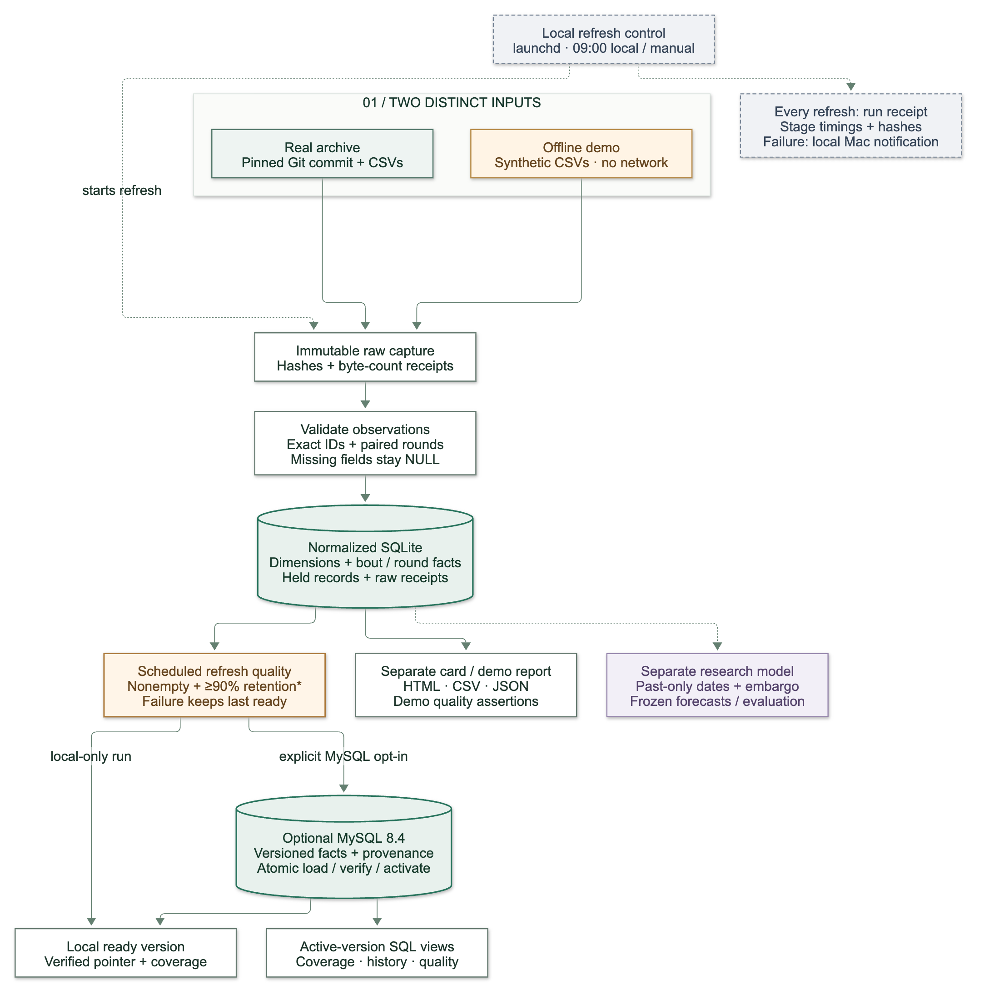
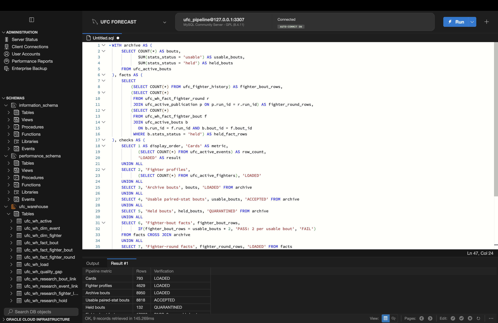
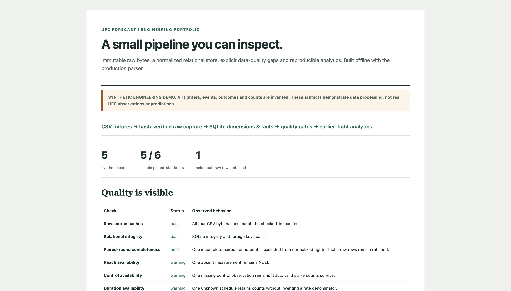

# UFC Forecast — Data Engineering Case Study

A reproducible data pipeline for combat-sports statistics: immutable source captures, a normalized relational store, explicit quality holds, historical analytics and optional transactional MySQL publication. The prediction model is a downstream consumer of that evidence.

**Explore:** [Architecture diagram](#architecture) · [Workbench and demo screenshots](#screenshots) · [Verified runs](docs/PIPELINE_VERIFICATION.md)

**Start with the portable demo.** With [uv](https://docs.astral.sh/uv/) and an installed Python 3.11+, run from a clean clone:

```sh
./scripts/demo.sh
```

After running the command, open `output/pipeline-demo/index.html` locally. This command runs entirely offline, uses checked-in **synthetic** fixtures and requires no API keys, private database or package installation. It calls the same normalizer and card-statistics code used for the retained research archive. Repeating it verifies and reuses the existing edition without changing its files. Use `--output-dir output/ANOTHER-DEMO-EDITION` after changing code or fixtures.

| Inspect | Default artifact |
|---|---|
| Pipeline and quality overview | `output/pipeline-demo/index.html` |
| Raw capture hashes and byte counts | `output/pipeline-demo/raw/manifest.json` |
| Normalized dimensions and facts | `output/pipeline-demo/normalized/statistics.sqlite` |
| Missingness, held rows and coverage | `output/pipeline-demo/reports/quality.json`, `output/pipeline-demo/reports/coverage.csv` |
| Earlier-fight sample analytics | `output/pipeline-demo/reports/card-statistics.html` |
| Code, inputs and output fingerprints | `output/pipeline-demo/run-manifest.json` |

The small demo deliberately includes missing reach, missing control time, unknown fight duration and an incomplete paired-round bout. Missing values remain `NULL`; incomplete bouts stay visible as held records. Every fixture is invented and clearly labeled. The demo does not fit a winner model or make real predictions.

Read the [data engineering case study and architecture](docs/DATA_ENGINEERING_CASE_STUDY.md), [MySQL warehouse and analytical SQL](docs/MYSQL_WAREHOUSE.md), and [refresh, scheduling and failure recovery runbook](docs/PIPELINE_OPERATIONS.md). MySQL publication is opt-in:

```sh
./scripts/demo.sh --mysql --config "$HOME/Library/Application Support/UFCForecast/pipeline-env.json"
```

That optional command requires the warehouse dependency and a configured project MySQL database. The [case study](docs/DATA_ENGINEERING_CASE_STUDY.md#optional-mysql-publication) and [local MySQL setup](docs/LOCAL_MYSQL.md) explain setup; the offline command above needs neither. Configuration and credentials stay outside Git and exported reports. A scheduled refresh and local database service are installed separately; running the demo installs neither.

The [local verification record](docs/PIPELINE_VERIFICATION.md) documents a real full-archive MySQL load, a successful launchd execution, a controlled failure alert and recovery, and the test evidence. The schedule is configured for 09:00 local time; execution was verified through a manual launchd kickstart. A clean clone requires its own setup. The local suite passed 554 tests with one gated MySQL test skipped; a separate warehouse run passed all 12 tests with real MySQL integration enabled. [GitHub Actions](https://github.com/tylerdobson/UFC-Prediction-Model/actions) tracks the hosted checks separately.

## Architecture

[](docs/diagrams/statistics-pipeline.svg)

The offline demo and real archive share the production normalizer. Scheduled refreshes additionally enforce dataset quality gates, publish a complete MySQL version when enabled, and then update the local ready pointer. Reports and the research model are separate consumers of earlier-fight evidence.

[Full-size SVG](docs/diagrams/statistics-pipeline.svg) · [Editable Mermaid source](docs/diagrams/statistics-pipeline.mmd) · [Export instructions and publication boundaries](docs/diagrams/README.md)

## Screenshots

**Actual MySQL warehouse.** Workbench connected to the project instance, with normalized tables and the archive verification query. The real archive contains 793 cards, 8,950 bouts, 8,818 usable paired-stat bouts and 132 held bouts. [Run the screenshot query](sql/mysql/portfolio_screenshot.sql).

[](docs/assets/screenshots/mysql-workbench.png)

**Offline synthetic demo.** Captured from the generated report in Chrome. The production parser retains missing values and holds an incomplete paired-round bout; all five cards and six bouts in this demo are invented.

[](docs/assets/screenshots/pipeline-demo.jpg)

[Screenshot provenance](docs/assets/screenshots/README.md). Screenshots are dated evidence; running the commands produces the current local artifacts.

## Model and prediction reports

A reproducible UFC winner model with a shareable, source-backed prediction report. The current edition forecasts **UFC 333: Volkanovski vs. Evloev, October 24, 2026**. It scores six matchups and lists all eight identity-held matchups without invented probabilities.

**Open the deliverable:** [PDF report](output/pdf/UFC-333-V6-Full-Statistics-Report.pdf) · [Browser report](output/ufc333-20261019-v6-final/prediction-report.html) · [CSV](output/ufc333-20261019-v6-final/prediction-report.csv) · [Forecast JSON](output/ufc333-20261019-v6-final/prediction-report.json)

## Reach and fight statistics

The reusable **all-card statistics pipeline** now supports archive refresh, historical backfill, per-card comparisons and evaluated model training. Start with [All-card statistics](docs/ALL_CARD_STATISTICS.md), or run `ufc-statistics --help`. The normalized store covers the retained archive rather than a single event; original databases and frozen reports are preserved.

All **12 scored fighters** have dated official reach and earlier-fight strike statistics available to V6. The report shows reach, strikes landed and absorbed per minute, striking accuracy and defense, takedown averages, and other available profile stats with units and sources. It records how many earlier fights supplied model statistics for each fighter.

The model uses opponent-adjusted accuracy from paired per-fight significant-strike counts, with whole event dates withheld until after prediction. Current career averages are displayed for context; they never replace earlier-fight inputs. Historical archive joins require exact names, date, outcome and complete paired rounds. Unresolved identities and genuinely absent granular fields remain explicit. Inconsistent official takedown-accuracy panels are omitted rather than corrected by guesswork.

## Model results

V6 adds ten striking and grappling metrics from the last five available fights, with shrinkage for small samples and whole-date ties. It retains V5's original history features. Three feature families were declared before development evaluation; the winner was frozen before the reused fixed benchmark was evaluated. Promotion required lower development and fixed log loss, no decrease in fixed winner accuracy, and sufficient coverage.

| Comparison | Bouts | V5 accuracy | V6 accuracy | V5 log loss | V6 log loss |
|---|---:|---:|---:|---:|---:|
| Fixed historical benchmark | 1,447 | 59.16% | **61.30%** | 0.66144 | **0.65217** |
| Rolling audit, 2016–2026 | 5,278 | 59.98% | **61.63%** | 0.65952 | **0.65360** |
| Latest partial year, 2026 | 398 | 57.29% | 57.29% | **0.67366** | 0.67830 |

V6 makes **31 more correct picks** on the fixed benchmark. Its paired event-date bootstrap loss interval versus V5 is **[-0.01715, -0.00136]**. The 2026 slice has unchanged pick accuracy and worse probability log loss; the pooled gain does not establish improvement in the latest year.

These are reused retrospective benchmarks, not a fresh holdout or evidence of live profit. The rolling pool includes development years. Source, identity and selection uncertainty are outside the bootstrap interval. Historical reach is an approximate static attribute with unknown measurement dates. Full reach plus rich-stat coverage is 532/1,447 (36.77%) on the benchmark; missing evidence remains explicit.

The all-card store retains **793 cards, 8,950 distinct bouts and 4,629 fighter profiles**. It has 8,818 usable paired-stat bouts (98.53%); 132 are held for identity, event or round-data gaps. Reach is available for 2,490 profiles; unavailable measurements are not invented. Reports can be generated for any retained card or a supplied future roster. The canonical archive spans March 1994 to October 17, 2026. Original research result labels remain frozen through September 19; rich history uses safely linked earlier archive fights without silently adding target labels.

## Reproduce and verify

Use Python 3.11+ from the repository root:

```sh
python3 -m venv .venv
source .venv/bin/activate
python -m pip install -e '.[dashboard,reports]'
python -m unittest discover -s tests
```

The delivered PDF, HTML, CSV and public JSON can be read without a database or API key. Regenerating forecasts requires the retained local research database and raw source captures; these are excluded from Git. Existing editions are preserved. See [the delivery record](docs/REPORT_DELIVERY.md) for exact experiment reproduction, source limitations and verification.

Generate a new, explicitly dated edition from verified captures:

```sh
ufc-model-report --card reports/ufc333_card_20261019.json \
  --statistics-db data/ufc_fight_statistics.sqlite \
  --athlete-facts reports/ufc333_fighter_stats_20261019.json \
  --output-dir output/NEW-FORECAST-EDITION
python scripts/render_prediction_pdf.py \
  output/NEW-FORECAST-EDITION/prediction-report.json \
  --output output/pdf/NEW-FORECAST-EDITION.pdf
```

Refresh source evidence before a later run. The saved card and athlete facts are timestamped snapshots, not live feeds. New reports reject changed evidence, post-cutoff captures, started events, missing core facts and ambiguous identities. A new event needs its own source-listed card and athlete manifests.

## Existing dashboard and operating workflow

```sh
python -m streamlit run app.py --server.address 127.0.0.1
```

The read-only dashboard remains available for saved operating, historical and forward-test evidence. Its older score-event research opt-in retains V3 defaults; the report generator selects the evaluated V6 policy when given `--statistics-db`. Fitting and ingestion run outside page requests. Operating alert and paper gates remain unchanged, and no component places wagers.

## Documentation

- [Data engineering case study and architecture](docs/DATA_ENGINEERING_CASE_STUDY.md)
- [MySQL warehouse, publication semantics and SQL](docs/MYSQL_WAREHOUSE.md)
- [Separate local MySQL instance and Workbench connection](docs/LOCAL_MYSQL.md)
- [Pipeline refresh, scheduling and recovery](docs/PIPELINE_OPERATIONS.md)
- [Verified local runs, tests and next increments](docs/PIPELINE_VERIFICATION.md)
- [All-card statistics, refresh and scoring guide](docs/ALL_CARD_STATISTICS.md)
- [V6 frozen protocol](reports/research_v6_protocol.json), [selection](reports/research_v6_selection.json) and [evaluation](reports/research_v6_evaluation.json)
- [All-card coverage JSON](reports/statistics_coverage_all_cards.json) and [CSV](reports/statistics_coverage_all_cards.csv)
- [Earlier V4/V5 report delivery](docs/REPORT_DELIVERY.md)
- [V5 frozen selection](reports/research_v5_selection.json) and [evaluation with per-bout predictions](reports/research_v5_evaluation.json)
- [V4 frozen selection](reports/research_v4_selection.json) and [evaluation](reports/research_v4_evaluation.json)
- [Current card](reports/ufc333_card_20261019.json) and [official athlete facts](reports/ufc333_fighter_stats_20261019.json)
- [Earlier V3 model card](docs/MODEL_CARD.md) and [upgrade report](reports/model_upgrade_summary.md)
- [Event workflow](docs/EVENT_WORKFLOW.md), [dashboard runbook](docs/DASHBOARD_RUNBOOK.md), and [source decision](docs/DATA_SOURCE_DECISION.md)

Earlier databases, source receipts and forecasts are preserved. This project is for research; historical performance does not guarantee future results.
