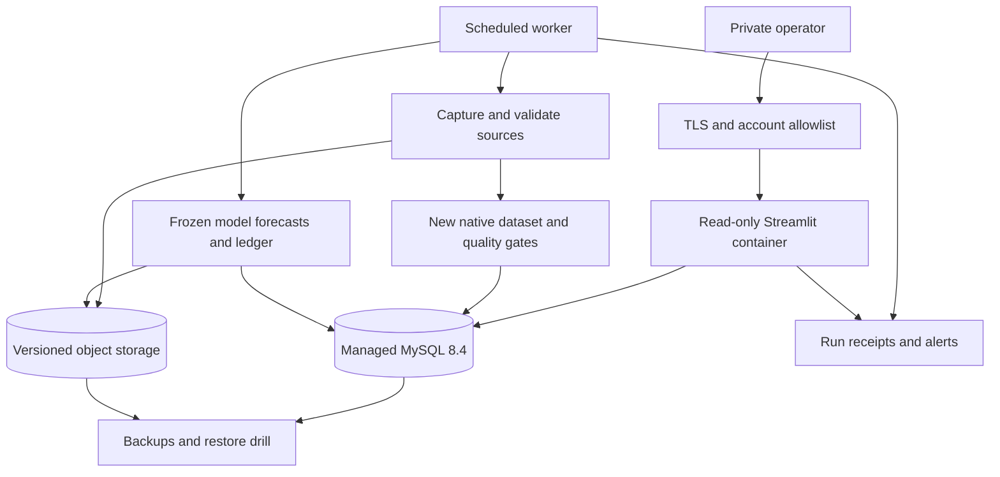

# Conditional deployment roadmap

**Status: proposed future plan, not authorization to provision or publish a service.** Evidence snapshot: 2026-10-20 UTC. The 72% accuracy target is unproven and may never be achievable across a broad UFC card population. This plan creates a way to test that target honestly; it does not promise a result or a completion date.

The retained V6 achieved **61.30% accuracy and 0.65217 log loss** on a reused 1,447-bout historical benchmark. The richer 43-feature V7 achieved **61.16% and 0.65386**, so it was not promoted. Both numbers describe the December 9, 2023–September 19, 2026 reused cohort, not a fresh holdout. The delivered V6 UFC 333 report scores 6 of 14 listed bouts; the eight withheld bouts remain explicit. The current prospective forecast set is pending, not a sufficiently large settled forward validation. See the [actual V7 comparison](../reports/mysql-v7-20261020/evaluation.json) and [frozen V6 edition](../output/ufc333-20261019-v6-final/prediction-report.json).

## Two distinct release levels

| Release | What it can claim | Required evidence |
|---|---|---|
| Private research / engineering case study | Reproducible data engineering, measured historical research, explicit missingness and a read-only dashboard. | Source permissions, integrity, authentication, recovery and deployment checks. It may remain below 72%; its limitations stay visible. |
| Performance-qualified model release | The exact frozen policy met the proposed accuracy, coverage, uncertainty and calibration gates on new data. | Every model gate below, followed by technical staging and a separately approved release. A point estimate alone does not establish a 72% underlying win rate. |

Neither release establishes positive betting returns, a market edge or operating eligibility. Forecast accuracy, calibration, price availability and financial performance are different quantities. No automatic wagering is planned.

## Freeze the evaluation contract first

Before collecting the first new test forecast, retain a signed protocol containing model/code hashes, feature definitions, source and identity rules, training/calibration boundaries, retraining schedule, prediction cutoff, candidate selection rule, baseline definitions, cohort dates, sample targets and all thresholds. Develop and choose candidates on earlier development data only. The already inspected historical benchmark cannot become fresh by renaming it or changing the split.

Use one final candidate per formal test. No feature tuning, confidence filters, division exclusions, metric switching or model selection using test outcomes. If the frozen policy permits retraining, only its predeclared schedule and earlier observed labels may be used; freeze each resulting model and prediction before its next decision cutoff. Earlier test predictions never change when later labels arrive. Evaluate the policy that actually produced those predictions.

Proposed population: every UFC card in a predeclared consecutive date window, across all divisions and both men's and women's bouts. Freeze one prediction per canonical bout at a fixed decision time, initially **24 hours before the verified card start**. This is a card-level timing convention, not an assertion that individual bout starts are known. Save source receipts, roster revision, feature cutoff, model version, both probabilities and the original prediction hash before that cutoff. Late additions, replacements and ambiguous identities become visible missing forecasts rather than silent exclusions.

Current official rankings and current career averages remain descriptive unless a dated pre-decision observation supports their use as features. Reach, styles, past methods and opponent strength need the same time and identity discipline as any other input. More features do not imply higher accuracy; V7 is a concrete example.

### Denominators and exclusions

| Measure | Predeclared definition |
|---|---|
| **Accuracy — the 72% target** | Correct higher-probability winner picks / frozen, scored, eligible settled binary bouts. Count each bout once. Predeclare a deterministic 50/50 tie rule. |
| Full-card prediction coverage | Frozen scored eligible binary bouts / **all eligible settled binary bouts on all included cards**. Held identities, missing inputs and late additions remain in this denominator. |
| Coverage-adjusted correct-decision rate | Correct picks / all eligible settled binary bouts. Optional supplementary metric; never label it accuracy or substitute it for the 72% target. |
| Nonbinary / unsettled cases | List cancellations, draws, no contests, unresolved outcomes and substitutions separately with source and reason. They do not silently disappear from the card reconciliation. |

Eligibility is about the predeclared event population and a source-verified binary outcome, not whether the model has convenient data. Show counts at every step: cards, roster slots, actually contested bouts, binary outcomes, scored bouts, correct picks, holds and pending cases. If outcomes cannot be reconciled reliably, keep the evaluation incomplete. Report confidence-filtered or division subsets only as secondary analyses alongside the whole-population result.

## Proposed model release gates

These are **project policy proposals**, not statistical guarantees, established industry standards or evidence already achieved. Freeze their final values before any new test outcomes are reviewed.

| Gate | Proposed acceptance rule |
|---|---|
| Fresh primary cohort | At least **1,000 scored, settled binary bouts**, **80 included events**, and **18 months** under one frozen policy. All cards in the registered window count. Collection may take **24+ months**; the sample is not guaranteed by a calendar deadline. |
| Broad coverage | At least **90% full-card coverage** overall and in each predeclared six-month block. Reconcile every card and publish the distribution of coverage by card/division. Do not remove low-coverage cards to improve accuracy. |
| Accuracy milestone | At least **72% observed accuracy** on the primary fresh cohort. Report the exact numerator, denominator, date range and full-card coverage beside that number. |
| Stronger 72% claim | For a performance-qualified **“72%+ validated”** release, also require a **one-sided 95% lower confidence bound at least 72%**, resampling whole events rather than treating bouts on one card as independent. A 72% point estimate alone does not pass this stronger gate. |
| Independent prospective confirmation | After primary evaluation, retain the same policy for a disjoint confirmation cohort of at least **300 scored binary bouts**, **25 events**, and **six months**. Require at least 72% point accuracy and 90% coverage, with a positive uncertainty-supported accuracy difference versus the frozen V6 baseline. No retuning between the two cohorts. |
| Probability quality | Better log loss than the frozen V6 and predeclared simple Elo baseline on identical scored bouts; require the paired event-bootstrap upper 95% bound for candidate-minus-baseline log loss to be below zero. Brier score must not worsen. Report calibration across fixed probability bins; proposed expected calibration error ceiling is **0.05**, with sample counts and uncertainty. Sparse bins cannot establish calibration. |
| Current-period robustness | Publish the entire registered window plus its predeclared six-month blocks and divisions. Investigate material recent deterioration; passing a pooled average cannot erase a failed confirmation cohort or coverage gate. |
| Market comparison, when available | Use genuine two-sided, same-book quotes captured before the same cutoff, a predeclared de-vig method and the same priced subset for both models. Publish quote coverage, source age and paired log-loss/Brier comparisons. Missing prices mean “market comparison unavailable.” They cannot support a financial-use claim. |
| Independent reproducibility | A reviewer reproduces predictions, coverage and metrics from the frozen manifests; verifies no current/future results, revised post-cutoff rosters or retrospectively captured facts entered an earlier decision. Record any remaining retrospective-source limitations. |

For uncertainty, predeclare the event-bootstrap procedure, number of resamples, random seed and confidence level. Apply it to paired predictions for model comparisons. This addresses shared event conditions but does not remove source bias, distribution shift or model-selection risk.

Close each cohort at its registered sample/time rule, retaining the complete final card. Do not repeatedly inspect results and stop when 72% appears. A failed cohort stays a failed recorded attempt. Any further candidate or formal test needs a new untouched cohort and a predeclared correction for repeated testing or sequential decisions; do not keep recycling the same holdout.

If 72% is not achieved, retain the best honestly evaluated model, publish the failure and continue as a research case study. Do not lower the coverage requirement or manufacture a “high confidence” headline after seeing results.

## Future architecture

This is a proposed hosted version of the existing stack, not a service that exists today.

- **Application:** retain the approved seven-section Streamlit interface in a pinned, non-root read-only container. Page requests read published evidence; they do not refresh sources, fit models or write ledgers. Begin with one private operator and a small deployment, then size from measurements.
- **Authentication:** build on the existing private Caddy / OAuth2 Proxy scaffold and test the account allowlist on every route, including WebSockets and downloads. The official integration uses Caddy `forward_auth`; the scaffold is not proof of a working hosted access boundary. [OAuth2 Proxy integration](https://oauth2-proxy.github.io/oauth2-proxy/configuration/integrations/caddy/).
- **Database:** managed MySQL 8.4 on a private network, separate application-read, worker-write, schema-installer and backup roles. Add and test verified database TLS/CA/hostname configuration before moving beyond the current local connection setup. Validate the project's integrity triggers and schema privileges on the chosen managed service. [MySQL encrypted connections](https://dev.mysql.com/doc/refman/8.4/en/using-encrypted-connections.html).
- **Worker:** a separate scheduled container replaces the workstation LaunchAgent in hosting. Keep one refresh publisher initially, use explicit timezone-aware schedules, idempotent retries and publication locks, and add pre-card captures as the frozen source contract requires. Scheduled refresh and model promotion remain separate jobs.
- **Evidence storage:** encrypted, versioned object storage for raw captures, model artifacts, frozen reports and run manifests. Add a tested hash-verifying storage adapter/cache because current receipt checks resolve filesystem paths. Preserve original receipt records; do not rewrite old evidence to make a migration appear current.
- **Secrets:** inject only each service's required credentials from private secret files or the selected platform's secret service. The dashboard gets no data-provider key or schema-administrator credential. Support rotation and prove secrets stay out of images, exports and logs. [Docker Compose secrets](https://docs.docker.com/compose/how-tos/use-secrets/).
- **Delivery:** build/test an immutable image from an exact Git SHA, publish to staging, exercise recovery and authentication, then approve a private production cutover. Prefer short-lived workload credentials for cloud CI rather than long-lived deployment keys. [GitHub Actions OIDC](https://docs.github.com/en/actions/concepts/security/openid-connect).

The native statistics alias and its publication receipt commit together. Analytical warehouse publication is a separate validated transaction; retry/reconciliation must handle the boundary. Do not describe a deployment, object upload and multiple stores as one atomic transaction.

## Phases, owners and acceptance

The same person may fill more than one role, but evidence review should be distinct from the implementation that produced it.

| Phase | Responsible role | Deliverable / acceptance |
|---|---|---|
| 1. Freeze the research plan | Model owner + reviewer | Register candidate policy, untouched cohorts, baseline/coverage rules and uncertainty before new test forecasts. Confirm source permissions for the intended private display. |
| 2. Improve and collect evidence | Model owner + data engineer | Resolve identity/coverage gaps, use bounded development experiments, freeze prospective predictions and reconcile every card. Publish failures as well as successes. No automatic V7 promotion. |
| 3. Qualify model performance | Reviewer | Reproduce both fresh cohorts and every model gate. Publish a dated pass/fail report with denominators; 72% remains unqualified if the confidence or coverage gate fails. |
| 4. Prepare private staging | Platform owner | Select a provider only after current quotations; validate managed-MySQL compatibility, TLS, secrets, worker scheduling, object receipts and all seven UI sections. An optional research-only staging release is labeled separately from model qualification. |
| 5. Rehearse recovery and cutover | Platform owner + operator | Green CI for the exact release SHA, clean native bootstrap, failed-source/duplicate-job drills, authenticated access tests, hash-matched exports and a timed restore into a separate namespace/environment. |
| 6. Release and observe | Operator + release approver | Approve the concrete deployment, budget and evidence; begin a private canary. Record the image digest, active model/data pointers and rollback target. No infrastructure purchase, DNS change or public launch is authorized by this plan. |

Before release, the hosted CI run must actually pass its native MySQL service, schema/constraint, publication/rollback, clone/workflow, backup/restore, no-SQLite-demo, seven-tab and container checks. Local test counts and the presence of a workflow YAML file are not substitutes for the run result.

## Monitoring, recovery and rollback

Track both serving health and data health: last successful worker run, source/roster/quote ages, held counts, coverage changes, failed quality gates, publication version, prediction cutoff, settlement backlog, DB errors, object checksum failures and backup age. An HTTP health response alone does not establish fresh inputs or model readiness.

Proposed initial alerts: worker failure immediately; no successful daily refresh for 26 hours; failed publication/hash check immediately; missing required pre-card evidence before the registered prediction cutoff; backup or restore-drill failure. Deliver alerts to the operator using an explicitly configured destination and test both delivery and acknowledgment. A failed source keeps the prior data version, visibly dated; it cannot relabel stale data as fresh.

Proposed recovery objectives are **15-minute database RPO** and **four-hour RTO**, subject to provider capability and a measured drill. Retain full backups plus the binary logs needed for point-in-time recovery, and verify object versions and forecast/document receipts together. Managed backups alone do not prove that raw source files or model artifacts can be restored. MySQL's recovery process starts from a full backup and applies later changes. [MySQL point-in-time recovery](https://dev.mysql.com/doc/refman/8.4/en/point-in-time-recovery.html).

Rehearse restore before launch and at least quarterly afterward. Restore into a new environment/namespace, check exact source and row fingerprints, ledger chain/tail, model and release hashes, and all seven UI sections. Record measured recovery time and any data loss; do not claim the objectives were met before that evidence exists.

Rollback keeps the prior image digest, model artifact and approved dataset pointers available. Quarantine a failed new version; never overwrite frozen forecasts or source receipts. Roll back application/model selection independently from data restoration, verify schema compatibility, and rerun publication reconciliation where separate stores are involved. If source timing or integrity is doubtful, show unavailable evidence and suspend new decisions while retaining the audit trail.

## Budget decision before provisioning

No provider, price or purchase is selected here. Obtain dated official quotations for the chosen region and actual workload, then approve a monthly cap and overage policy.

| Cost component | Inputs to quote |
|---|---|
| App and scheduled worker | Memory/CPU, replica count, worker runtime/frequency and build/registry storage. |
| Managed MySQL | Instance size, storage/IO, private networking, availability tier, backup retention and binary-log/PITR retention. |
| Evidence/object storage | Retained bytes and versions, requests, retrieval/egress, encryption and backup copies. |
| Data and operation | Permitted source/API access, quote history/quotas, logs/alerts, domain/TLS setup and operator review time. |

Accuracy does not determine infrastructure cost, and infrastructure does not improve model accuracy. Complete research qualification and practical staging checks before representing the system as a performance-qualified hosted product.
